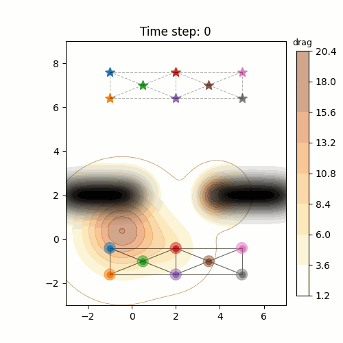

# gifs_distributed_relaying_PB

Animations accompanying the paper: 8 robots moving to a target formation through terrain with drag patches.

Each row is one target formation. The left column shows the baseline with the PB operator switched off (u = 0, inner PI loop only). The right column shows the trained distributed PB controller.

| Target | Without PB | With PB |
|:---:|:---:|:---:|
| **Direct**: formation translated only |  |  |
| **Flip**: formation rotated by π |  |  |
| **Offset**: formation shifted right and rotated by π/2 |  |  |
