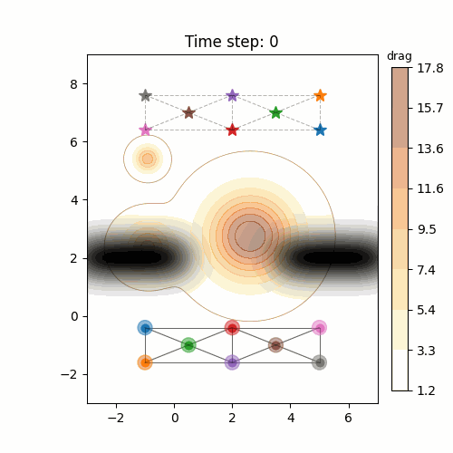
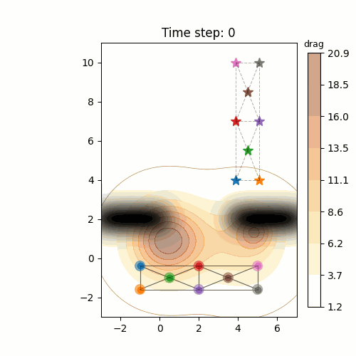

# gifs_distributed_relaying_PB

Animations accompanying the paper: 8 robots moving to a target formation through terrain with drag patches.

For each target formation, the left GIF shows the baseline with the PB operator switched off (u = 0, inner PI loop only). The right GIF shows the trained distributed PB controller.

## Direct target: formation translated only

  
  &nbsp;&nbsp;
  

<em>Left: without PB. Right: with PB.</em>

## Flip target: formation rotated by π

  
  &nbsp;&nbsp;
  

<em>Left: without PB. Right: with PB.</em>

## Offset target: formation shifted right and rotated by π/2

  
  &nbsp;&nbsp;
  

<em>Left: without PB. Right: with PB.</em>

